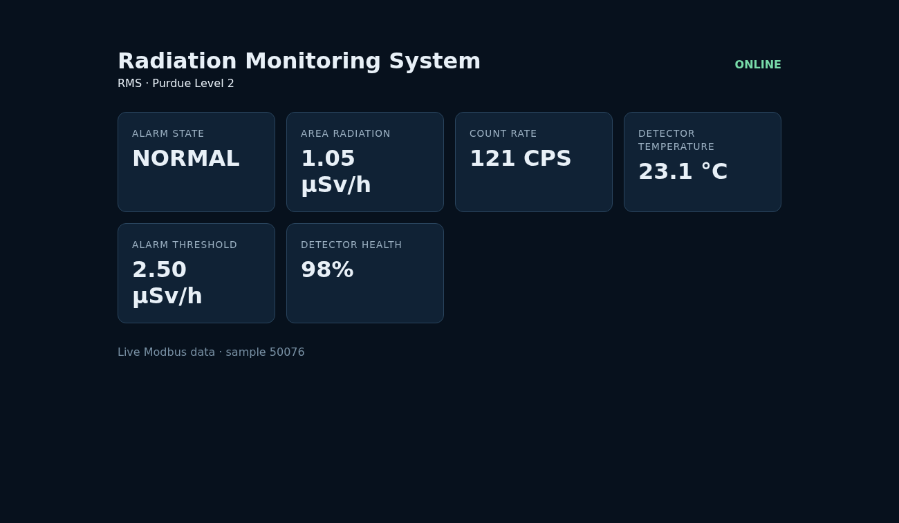

# Purdue Model Annotation - Radiation Monitoring System
## Santiago Vargas | October 15, 2026

**System:** RMS, logically Purdue Level 2, account `rms` on
`plant.sanctumsec.com`. This annotation distinguishes architectural intent,
source implementation, dated lab observations, and unverified assumptions.

## Topology Evidence

I retrieved the real [status board](https://plant.sanctumsec.com/) and its
`/api/v1/status` response on October 15 MDT. The API's generation time was
`2026-10-16T04:49:04Z` (October 15, 22:49:04 MDT). The board groups the student
systems as follows:

| Logical level | Student systems |
|---|---|
| L1 | EDGC, RPS, SFPCM |
| L2 | DCS, RMS, SMR, TCS |
| L3 | PSI |

Only the public board was read; no reference-system endpoint or other student's
service was contacted during this review. The RMS board record reported online,
9/10 milestones, and `peer=false`. That last flag does not erase the dated W3
peer response or W4 coordinated gateway evidence. Its detection criteria are not
available here, so neither current peer connectivity nor segmentation follows from it.

The course architecture's RMS links are reproduced in the assigned
[W3 brief](../week-03/README.md#your-links): RMS -> DCS, analog + Modbus, and
RMS -> OT-SIEM, syslog / OPC-UA, both one-way out. These describe intended
relationships, not the exact deployed transport. The standalone architecture
page/diagram was not supplied in this checkout or linked by the live board.
**Evidence limitation:** I could not independently annotate that original page;
this document uses its course-provided link table and does not pretend to have
viewed the missing diagram. Its URL or image is still needed for full rubric coverage.

### Own HMI Screenshot



This is an actual authenticated browser capture of
`https://rms.plant.sanctumsec.com/`, not a reconstructed dashboard. A temporary
local browser helper used the provisioned credential privately in memory and
confirmed `ONLINE` before saving the image. No password or token is in the image.
The dashboard's 3-second client poll reads six holding registers and two coils;
it supplies no control-write route. An unauthenticated direct request to our
`127.0.0.1:5060/api/status` returned 401. All three RMS units were active, and a
separate device-1 FC3 read returned `[89, 103, 247, 250, 98, 49970]`, including
threshold 250. See [collection evidence](session-log.md#october-15-collection).

## Logical Zones Versus Host Reality

The eight student systems share the same machine and loopback interface. For RMS,
`127.0.0.1:5061` means local-to-the-shared-host, not private-to-the-`rms`-account.
The L1 SFPCM and L2 RMS labels therefore do not imply a router, firewall, separate
network namespace, data diode, or separate host between those accounts.
Loopback binding limits external network exposure; it does not implement a Purdue
zone boundary or authorize local clients. No host-level isolation was established.

The actual source/evidence-supported paths are:

```text
Browser -> lab HTTPS routing -> HTTP 127.0.0.1:5060, shared Basic auth
                            -> raw Modbus TCP 127.0.0.1:5061, device 1
SFPCM enrolled credential -> mutual TLS 127.0.0.1:5062, partner_read
                         -> permitted FC1/FC3 requests to 5061
RMS event dependency -> configured HTTP(S) JSON ingestion API, bearer token
```

The backend is reachable by its own maintenance account without a Modbus identity.
Attack A verified that this route accepted raw 301 despite the policy band.
Attack C originally verified the partner relay path accepted a write; the later
gateway denied that operation. Neither test demonstrates direct-backend isolation
from SFPCM. No new direct peer path or scan was used to resolve that uncertainty.

## Boundary Crossings

| Connected peer / direction | Protocol / endpoint | Purdue crossing | RBAC policy says | Host/application actually enforces |
|---|---|---|---|---|
| Operator browser -> RMS HMI | HTTPS public URL -> HTTP 5060 -> Modbus 5061 | Viewer location unspecified -> L2; not evidence of L3/L4 placement | Authenticated status viewing; no threshold writes | Shared Basic-auth pair, protected read-only routes; public TLS routing is provided by the lab, its configuration is not in this repo |
| SFPCM -> RMS, agreed new path | mTLS Modbus frames, `127.0.0.1:5062 -> :5061`, device 1 | L1 -> L2 | Enrolled `partner_read` credential may read documented points, never write | CA validation plus SHA-256 allowlist; FC1 offsets 0-1 / FC3 offsets 0-5 only; October 13 FC6 denied `8601`, threshold stayed 250; no verified backend isolation |
| RMS -> SFPCM, agreed reciprocal comparison | HTTP/JSON `127.0.0.1:5022/v1/temperature-alarm` | L2 -> L1 | Scoped read-only partner access | Recorded peer gateway GET 200, unauthenticated 401, authenticated POST 403; peer-owned control, not an RMS permission mechanism |
| RMS -> DCS, intended architecture link | Brief: analog + Modbus; W3 peer response at `127.0.0.1:5051` | L2 -> L2 | Status relationship, not blanket write permission | Historical response/capture, but no continuous export/consumer in RMS source; actual analog path not implemented here; current peer authorization not rechecked |
| RMS -> OT-SIEM | Actual JSON HTTP(S) POST to provisioned `OT_SIEM_URL`; not implemented syslog/OPC-UA | L2 -> supervisory monitoring; collector level not verified in status board | Truthful monitoring only, no control return path | Bearer ingestion token authenticates source, not event truth or human actor; sampled reads, memory queue, losses possible; ordinary monitoring is not permission to attack SIEM |
| RMS maintenance account -> own backend | Raw Modbus TCP `127.0.0.1:5061` | No network-zone crossing despite distinct human policy roles | Approved maintenance threshold raw 200-300, acknowledgement separately scoped | Address/function allowlist only, no authenticated role/range/approval; October 14 raw 301 accepted then restored |

## AI Annotation Check and Gaps

A diagram-only annotation could equate separate L1/L2 boxes and loopback binding
with enforced separation. I explicitly challenged that inference against
`rms_server.py`, the gateway implementation, and the recorded attack readbacks.
The claim is false for this topology: the gateway protects a selected endpoint,
not every route to the backend. This is a checked counterexample, not a fabricated
quotation from an earlier AI session.

The diagram also cannot establish seven implemented roles, individual HMI identities,
approved numeric ranges, one-way networking, or immutable monitoring. They are
separate controls requiring evidence. The code implements one shared HMI identity
and one gateway role; the backend lacks identity. The event transport differs from
the architecture's generic labels, and no DCS process-consumer loop was verified.
Attack B is Untestable in the current permitted scope; false SIEM telemetry is
explicitly excluded, not a substitute for a downstream experiment.

The [RBAC limitations](rbac-policy.md#what-this-policy-cannot-enforce),
[revision table](adversary-test.md#revised-policy-items), and [RUNBOOK](RUNBOOK.md)
carry these gaps forward so the W5 operator does not infer protection from a
Purdue label, an active unit, or a SIEM acknowledgement.
